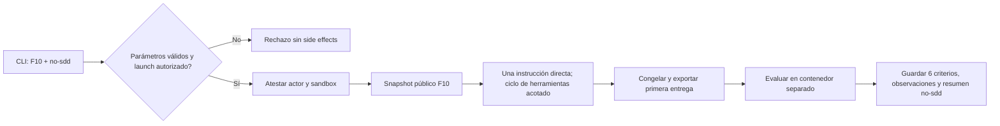
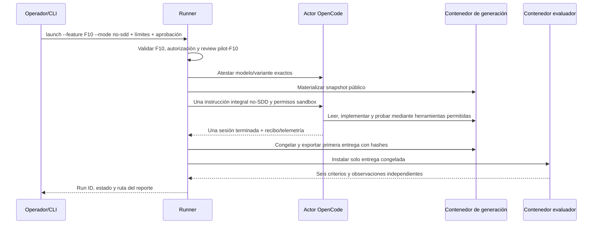

# Diseño — Condición experimental F10 sin SDD

- Modo SDD: standard
- Fase: Design
- Estado: aprobado para Tasks
- Gate 1: aprobado explícitamente por el usuario
- Gate 2: aprobado explícitamente por el usuario («procede»)
- Spec relacionada: `.sdd/specs/laboratorio-evaluacion-sdd/`
- Estrategia de pruebas: TDD focalizado para comportamiento nuevo del runner; regresión para los dos modos existentes

## 1. Contexto y alcance

El runner existente secuencia fases SDD, verifica artefactos estructurales y luego
exporta/evalúa la primera entrega. El actor OpenCode añade a su configuración una
política derivada del hash de la skill SDD; por ello no basta con cambiar el prompt
de usuario: la condición nueva necesita evitar tanto las fases/documentos como esa
política SDD en el contexto del candidato.

La extensión conserva el scaffold, contrato, snapshots, evaluación F10 y controles
operativos. No implementa la saga ni modifica el evaluador. Solo acepta `no-sdd`
junto con `F10`. Una invocación del actor ejecutará el ciclo de herramientas hasta
terminar o agotar límites; el runner congela y evalúa la primera entrega, sin loop de
reparación.

## 2. Solución por capas

- **CLI / autorización:** añadir `no-sdd` a `--mode`; rechazarlo con cualquier
  feature distinta de F10 antes de crear carpetas, instanciar OpenCode o Docker.
  `dry-run`, `prepare` y `launch` conservan su semántica. `launch` mantiene el gate
  `pilot-F10`, la autorización expresa, la atestación del modelo/variante y límites.
- **Request / orquestación (`pilot.py`):** permitir el modo solo para F10. En este
  modo crear una única etapa `no-sdd`, no validar artefactos `.sdd`, no ejecutar la
  comprobación de transición estructural y continuar a la congelación/exportación.
  Los modos preexistentes mantienen idénticas etapas y validaciones.
- **Prompt del candidato:** una instrucción integral pide resolver F10 según el
  `CONTRACT.md`, modificar solo `Saga.submit`, `Saga.step` y `Saga.get`, usar las
  herramientas públicas para inspección/pruebas locales y finalizar al completar.
  No pide planificación, fases, aprobaciones, documentos SDD ni reporte de
  cumplimiento SDD. Sigue prohibiendo acceso/feedback del evaluador y reparaciones
  después del veredicto.
- **Integridad del alcance F10:** después de exportar y antes de evaluar `no-sdd`,
  comparar el AST del `feature.py` candidato con el snapshot, sustituyendo únicamente los cuerpos de
  `Saga.submit`, `Saga.step` y `Saga.get` por marcadores normalizados. Rechazar
  cambios a imports, firmas, clases, scaffold, helpers y métodos ajenos. El validador
  dedicado F10 procesa sintaxis como dato en host y nunca importa/ejecuta el
  candidato; conservar también los hashes originales y del candidato.
- **Actor OpenCode:** para `no-sdd`, la política de sistema describe únicamente la
  condición directa, el alcance permitido y el uso exclusivo del sandbox. No incluye
  texto ni hash de procedencia de la skill SDD. `canonical_sdd_sha256` será `null`
  para esta condición; los otros modos siguen requiriendo y registrando el hash.
  El run conservará hash/digest de la condición, contrato/snapshot y prompt efectivo
  para identificar qué recibió el modelo. No se persiste el contenido de credenciales.
- **Entrega/evaluador:** reutilizar el export allowlist que ya admite `feature.py`
  y documentos SDD opcionales; exportar `feature.py`, verificar hashes, e instalarla
  en un contenedor de evaluación distinto. Correr el grader F10 confiable existente
  y persistir observaciones y resultados por criterio.
- **Resumen:** registrar condición `no-sdd`, una invocación/fase `no-sdd`, digest de
  instrucción/contrato/snapshot, telemetría expuesta y los seis resultados; no
  presentarla como SDD canónico ni mezclarla con métricas previas.

## 3. Flujo

## 4. Secuencia de ejecución

## 5. Datos, errores y controles

- Extender `PilotRequest.mode` sin ampliar la whitelist de features. Validación
  inválida debe ocurrir antes de cualquier efecto externo.
- El código candidato sigue siendo dato: no importarlo ni ejecutarlo en host; el
  evaluator trust boundary y almacenamiento reservado no cambian.
- Los fallos de transporte, actor, presupuesto, exportación y evaluación conservan
  clasificación y sanitización existentes. Una ejecución sin entrega íntegra no
  obtiene veredicto funcional.
- Si el AST no puede analizarse o detecta cambios fuera de los tres cuerpos
  permitidos, clasificar como fallo de contrato/entrega y no invocar el evaluador.
- El sistema OpenCode debe aceptar hash canónico `null` solo en `no-sdd`; mantener
  bloqueado cualquier modo SDD sin hash. Los recibos guardan null explícito y el
  digest de política/prompt identifica la instrucción alternativa.
- La ejecución real requiere revisión F10 vigente y fingerprints coincidentes.
  Como el fingerprint incluye `pilot.py`, `pilot_cli.py` y `opencode_actor.py`, los
  cambios de esta feature volverán obsoleto el review F10 actual; no se reutiliza
  waiver F01–F04. La implementación no crea ni suplanta una revisión.
- Límite de una sola etapa del actor no equivale a un solo paso de razonamiento:
  el stream conserva su loop de herramientas, sujeto a max_steps, tiempo y coste.

## 6. Invariantes críticos

1. `no-sdd` solo puede ejecutarse con target F10; combinaciones inválidas no crean
   runs ni invocan Docker/OpenCode.
2. Una ejecución `no-sdd` hace exactamente una llamada de fase al actor y nunca exige
   o valida artefactos SDD; otros modos no cambian su secuencia.
3. La entrega se congela antes de evaluación y se evalúa en un contenedor distinto;
   el candidato nunca recibe el oráculo ni los criterios reservados.
4. Sin aprobación, atestación exacta, límites válidos o revisión F10 vigente no hay
   llamada de modelo.
5. Ningún cambio candidato fuera de los tres cuerpos F10 se acepta ni ejecuta en host.

## 7. Estrategia de pruebas

- **TDD focalizado:** RED/GREEN para request/CLI (solo F10), secuencia de una etapa,
  prompt sin referencias a SDD, bypass exclusivo de artefactos estructurales y
  aceptación de hash canónico nulo solo para `no-sdd`; RED/GREEN para el guard de AST
  con los tres cuerpos permitidos y mutaciones fuera de alcance.
- **Dry-run integrado, cero modelos:** confirmar generación → congelación → entrega →
  grader confiable falso, un identificador nuevo, reporte `no-sdd` y ninguna escritura
  de documentos SDD. La calibración real del grader F10 existente permanece sin
  cambios; no lanzar modelos durante tests.
- **Regresión:** ejecutar pruebas existentes de `pilot.py`, CLI, actor, stream,
  exportación, F10 RPC/evaluador y review gate; comprobar que lite/standard conservan
  etapas, hash SDD obligatorio y rechazo de artefactos ausentes.
- **Negativas:** modo no-SDD con F01/F07/X13, recibo de modelo/variante discrepante,
  presupuestos ausentes, review F10 stale, actor incompleto, entrega alterada y
  cambios AST en imports/firmas/helpers, resultados/evidencia ausentes deben bloquear
  o clasificarse sin falso éxito.
- No se añade PBT: los invariantes relevantes son límites de flujo y aislamiento,
  cubiertos con casos de ejemplo y seams reales del runner/sandbox.

## 8. RNF y calidad

- RNF-1: cero invocaciones de modelo en la suite de implementación y dry-run.
- RNF-2: código candidato solo corre en los contenedores aislados de generación y
  evaluación; nunca se importa en el host.
- RNF-3: ninguna entrega/veredicto se sobrescribe; identidad nueva por ejecución y
  hashes verificables de snapshot, contrato, prompt y entrega.
- RNF-4: salida CLI/reportes no exponen credenciales, datos de auth ni excepciones
  crudas del frontend.
- RNF-5: fallos o límites no se clasifican como éxito funcional; primera entrega y
  resultado externo permanecen vinculados al mismo run.

Capas: CLI → request/runner → actor/sandbox inyectables → contenedores. El dominio de
F10 y el grader no dependen del modo. Persistencia y Docker siguen encapsulados en los
módulos existentes. Los errores permanecen tipados/sanitizados. Se reutiliza el
composition root existente (`pilot_cli.main`); no se añade infraestructura singleton.

## 9. Supuestos y exclusiones

- Se reutiliza el mismo contrato, scaffold publicado, evaluador F10 calibrado y los
  mismos puntos modificables que el intento previo.
- Un futuro intento independiente usará configuración y límites aprobados para ese
  kickoff; no hereda presupuesto, consentimiento de gasto ni review de la ejecución
  histórica.
- La ejecución es de una primera entrega, no una campaña repetida ni una comparación
  causal general entre modos.
- No se modifica `canonical/`, `generated/`, `.gitignore`, contrato ni evidencia
  histórica de F10.

## 10. Excepciones al quality-bar

Ninguna. No se añade persistencia del dominio ni capa nueva; se extienden puntos de
composición del runner y sus tests.

Gate 2 aprobado: diseño autorizado para Tasks.
