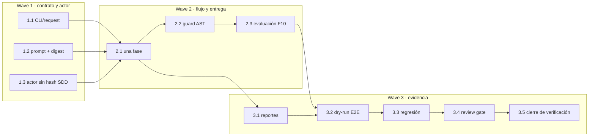

# Tareas — Condición experimental F10 sin SDD

- Modo SDD: standard
- Fase: Tasks
- Estado: implementación y Verification completas; spec cerrada
- Gate 1: aprobado explícitamente
- Gate 2: aprobado explícitamente («procede»)
- Gate 3: aprobado explícitamente por el usuario («procede»)
- Gate 4: aprobado por el usuario («continua») tras la solicitud conjunta de cierre y kickoff
- Intención: implementar el modo experimental; no incluye lanzamiento real ni consumo del modelo
- Testing: TDD focalizado para comportamiento nuevo; regresión para los modos existentes

## Convenciones y límites

- Código del laboratorio: `.agent-lab/sdd-escalation/`; esta spec y sus decisiones:
  `.sdd/specs/laboratorio-evaluacion-sdd/f10-no-sdd/`.
- No cambiar el contrato F10, snapshots, suite reservada, resultados históricos,
  `.gitignore` ni las skills canónicas.
- No realizar llamadas al modelo. Los dry-runs y pruebas usan actor falso y servicios
  inyectados. Ejecutar candidato/evaluador solo en los contenedores que el harness
  administra; nunca importarlo o ejecutarlo en el host.
- Para cada comportamiento nuevo, TDD focalizado: observar RED por la razón esperada,
  GREEN mínimo correcto y refactor solo si existe duplicación o responsabilidad real.
- No marcar `[x]` sin artefacto y evidencia verificada. Una prueba del review gate no
  equivale a completar/actualizar el review real F10.
- El Gate 3 aprueba empezar la implementación de esta variante, no autoriza un kickoff.

## Wave 1 — Contrato de modo, CLI y prompt directo

- [x] 1.1 [TDD focalizado] Extender validación de `PilotRequest` y CLI para `no-sdd`
  exclusivamente con F10; comprobar que combinaciones incompatibles se rechazan antes
  de crear runs, iniciar contenedores, preparar actor o invocar OpenCode. RED → GREEN
  mínimo → REFACTOR si aporta valor. Evidencia: tests `test_no_sdd_request_is_f10_only`,
  `test_no_sdd_cli_is_f10_only_and_has_no_sdd_hash` y
  `test_no_sdd_rejects_other_feature_before_side_effects`. (R1.1, R3.1)
- [x] 1.2 [TDD focalizado] Crear el prompt integral F10 de `no-sdd` y la política de
  sistema correspondiente: una sola fase, sin mencionar/exigir etapas o artefactos SDD,
  puntos de cambio F10 acotados, sin feedback reservado ni reparación. Añadir digest
  reproducible de prompt/condición al registro. RED → GREEN mínimo → REFACTOR si aporta
  valor. Evidencia: `test_no_sdd_prompt_is_one_integral_task_without_sdd_artifacts`;
  digest registrado en `pilot-0f90cd5e-5fa4-48aa-8acc-d66d5ffe72f0/summary.json`.
  (R1.2, R2.2, R2.3)
- [x] 1.3 [TDD focalizado] Permitir `canonical_sdd_sha256=None` solo para `no-sdd` en
  actor/config/recibo; mantener exigencia del hash para `lite-experimental` y
  `standard-autonomous`. Confirmar que la configuración no incluye política ni
  procedencia de SDD para la condición nueva y que el actor conserva auth opt-in,
  permisos mínimos y atestación exacta. RED → GREEN mínimo → REFACTOR si aporta valor.
  Evidencia: `test_no_sdd_actor_accepts_null_hash_without_sdd_policy` y regresión
  `test_version_drift_and_missing_hash`. (R1.2, R2.2, R3.1–R3.2, R3.5)

## Wave 2 — Ejecución acotada e integridad de entrega

- [x] 2.1 [TDD focalizado] Añadir ruta `no-sdd` al orquestador: invocar al actor una
  sola vez con el prompt integral, no exigir ni validar archivos `.sdd`, congelar la
  generación y continuar al export/evaluación; conservar idénticas etapas y controles
  de los otros modos. Cubrir éxito, límite y actor incompleto. RED → GREEN mínimo →
  REFACTOR si aporta valor. Evidencia: `test_no_sdd_runs_one_direct_phase_and_evaluates_f10_without_sdd_docs`,
  `test_no_sdd_preserves_first_delivery_when_actor_hits_a_limit` y
  `test_no_sdd_time_limit_preserves_delivery_without_claiming_evaluation`.
  (R1.1–R1.5, R3.3, R3.5)
- [x] 2.2 [TDD focalizado] Implementar comparación AST F10 sobre el snapshot y la
  entrega exportada, sustituyendo solo los cuerpos de `Saga.submit`, `Saga.step` y
  `Saga.get`; rechazar antes de evaluar cambios en imports, firmas, helpers, clases,
  scaffold o métodos ajenos. El validador analiza texto como dato, nunca importa ni
  ejecuta candidato en host; registrar digests/hash de ambos artefactos. RED → GREEN
  mínimo → REFACTOR si aporta valor. Evidencia: tests `test_f10_scope_guard_*` y
  `test_no_sdd_rejects_out_of_scope_ast_without_evaluation`. (R1.3, R2.2, R2.4, R3.2, R3.4)
- [x] 2.3 [TDD focalizado] Vincular la ejecución aceptada con el evaluador F10 ya
  calibrado: usar contenedor de evaluación nuevo, ejecutar F10-01–F10-06 y persistir
  resultados/observaciones con el run. Clasificar AST inválido/cambios fuera de
  alcance, export incompleto y evaluación no íntegra sin falso éxito. RED → GREEN
  mínimo → REFACTOR si aporta valor. Evidencia: dry-run Docker real del actor fixture,
  grader F10 y criterios 6/6 en `pilot-0f90cd5e-5fa4-48aa-8acc-d66d5ffe72f0`.
  (R2.1, R2.4, R3.2–R3.3)

## Wave 3 — Evidencia, resumen y regresión integrada

- [x] 3.1 [TDD focalizado] Extender reportes/resúmenes para identificar `no-sdd`, una
  fase/invocación directa, ausencia explícita de hash SDD, digests de contrato,
  snapshot e instrucción, telemetría disponible, primera entrega y evidencia por
  criterio. Distinguir condición experimental de cumplimiento SDD y preservar runs
  históricos. RED → GREEN mínimo → REFACTOR si aporta valor. Evidencia: tests CLI y
  `summary.json` del run `pilot-0f90cd5e-5fa4-48aa-8acc-d66d5ffe72f0`.
  (R2.2–R2.3, R3.4–R3.5)
- [x] 3.2 Integración con actor falso: dry-run F10 recorre preparación, generación,
  congelación, validación de alcance, exportación, evaluación y reporte; verifica cero
  invocaciones de modelo y ausencia de archivos SDD obligatorios. Calibrar referencia
  y skeleton con la infraestructura actual sin modificarla. (R1.1–R1.5, R2.1–R2.4,
  R3.1–R3.3). Evidencia: run `pilot-0f90cd5e-5fa4-48aa-8acc-d66d5ffe72f0`:
  actor fake, 6/6, benchmark false y cero llamadas/invocaciones de modelo; calibración
  previa reference 6/6 y skeleton 0/6 en `runs/f10-calibration-adc8772351ac4ffbad57856b9fb57007/report.json`.
- [x] 3.3 Regresión del conjunto afectado: suites pilot, CLI, actor/stream, delivery,
  F10 RPC/evaluación y review gate. Confirmar secuencias de lite/standard, hash SDD
  obligatorio, rechazo de artefactos estructurales ausentes y protecciones de
  autorización/limites. Comprobar `no-sdd` rechaza features ajenas a F10. Evidencia:
  suite indicada en `verification.md`, 1008 passed, 2 skipped, 1 deselected.
  (R1.1, R1.5, R2.4, R3.1–R3.5)
- [x] 3.4 Comprobar que el gate de revisión F10 rechaza fingerprints obsoletos y que
  el resumen mantiene `no-sdd` separado; no crear ni falsificar registro de revisión.
  Documentar como prerequisito pendiente cualquier review real requerido antes de
  lanzamiento. Evidencia: `test_f10_review_binds_direct_mode_runner_and_stale_review_blocks`.
  (R2.3, R3.1–R3.2)
- [x] 3.5 Ejecutar suites y checks de calidad; completar `verification.md` con RED,
  GREEN, suite final, RNF, limitaciones, matriz Req→Task→Test→Evidencia y declaración
  explícita de cero llamadas a modelos. No lanzar ningún intento real. (R1.1–R1.5,
  R2.1–R2.4, R3.1–R3.5). Evidencia: `verification.md`, compileall y `git diff --check`.

## Grafo de waves

Implementación y Verification completadas sin invocar modelos. Gate 4 aprobado por
el usuario («continua») tras revisar el resumen de verificación y la solicitud
conjunta de cierre y kickoff. El intento real posterior es una operación separada,
autorizada con la configuración registrada en `verification.md`.
