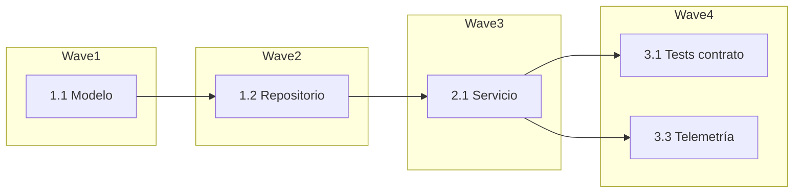

# Plantillas SDD

## requirements.md

```markdown
# Requisitos — <feature>

Modo SDD: standard
Fase: Requirements
Estado: en progreso
Gate 1: pendiente

## Calificación de feature (solo si SDD analizó una feature)
- Esfuerzo previsto del LLM: <1–10 o 10+; ver feature-level.md; no emitir antes de definir alcance>
- Referente del laboratorio: <referente>
- Justificación: <2–4 factores; explicar exceso sobre X13>
- Supuestos relevantes: <infraestructura/incertidumbres>
- Alcance evaluado: <resumen>
- Atención: <indicador/controles>
- Profundidad recomendada/seleccionada: <elección>
- Entrega: <dependencias/integración>

## Historia 1: <título>
Como <rol> quiero <objetivo> para <beneficio>.

### Criterios (EARS)
- Req 1.1: CUANDO <condición> EL SISTEMA DEBERÁ <comportamiento>
- Req 1.2: SI <error> ENTONCES EL SISTEMA DEBERÁ <manejo>

## Supuestos
- <supuesto explícito>
```

## design.md (standard)

```markdown
# Diseño — <feature>

Modo SDD: standard
Fase: Design
Estado: en progreso
Gate 2: pendiente

## Contexto y supuestos
## Arquitectura (capas)
## Componentes / módulos
## Modelo de datos (si aplica)
## Errores
## Requisitos no funcionales (RNF)
- RNF-1: <medible y verificable; se audita en Fase 4>
## Estrategia de pruebas
- Nivel: <sin test nuevo | caracterización/regresión | verificación focalizada>
- Justificación / excepción: <por qué>
## Invariantes críticos (0–5, opcionales)
## Excepciones al quality-bar
## Diagramas (flowchart + sequence)
```

## Artefactos lite

Quick Plan usa estas versiones compactas en una pasada. El marcador de modo es
obligatorio y una petición de solo planificación no crea evidencia de implementación.

## `spec.md` (SDD-Tiny)

Este único documento se crea antes de modificar código con estado `Planificado` y se
actualiza en el mismo path después de implementar. No se generan junto a él los
cuatro documentos de Standard ni los tres archivos de Quick Plan. Las cuatro
secciones son breves; adapta el número de criterios y checks al riesgo, sin exigir
EARS ni una matriz completa de trazabilidad.

```markdown
# SDD-Tiny — <feature>

Modo SDD: tiny
Estado: Planificado
Gate 3: pendiente | no aplica (solo planificación)
Calificación de feature (solo si corresponde): <Esfuerzo previsto del LLM; referente,
  factores, supuestos; atención; exceeds_x13=true/false>
Profundidad recomendada / seleccionada: <Direct | SDD-Tiny | SDD-Lite; elección explícita>

## Alcance y aceptación
- Objetivo y resultado esperado: <...>
- Comportamientos y criterios verificables: <...>
- Errores y casos límite: <...>
- Invariantes: <...>
- Exclusiones y supuestos: <confirmados / pendientes>

## Enfoque técnico y estrategia de pruebas
- Enfoque/patrones existentes: <...>
- Riesgos e invariantes que requieren pruebas: <...>
- Estrategia: <verificación focalizada | regresión/caracterización | sin test nuevo + razón>

## Checklist
- [ ] <resultado verificable>
- [ ] <test/check proporcional al riesgo>

## Verificación y cierre
- Estado inicial: Planificado; spec creado antes de cambios de producto.
- Gate 3: <pendiente | aprobado; cita de aprobación>
- Baseline o comprobación inicial: <comando y resultado realmente observado | pendiente>
- Verificación final: <comando y resultado realmente observado | no ejecutado>
- Fallos locales y reparaciones: <secuencia observada; no omitir fallos>
- Excepciones/limitaciones: <ninguna o explicación>
- Gate 4: <pendiente | aprobado | no aplica (solo planificación)>
- Estado final: <Completado | Parcial | Bloqueado | Planificado>
```

Solo una solicitud con intención de implementación puede avanzar después de aprobar
Gate 3; una planificación aceptada no autoriza cambios. No declares pruebas pasadas
si no se ejecutaron y no reemplaces ni elimines el historial de fallos al registrar
reparaciones.

### requirements.md (lite)

```markdown
# Requisitos — <feature>

Modo SDD: lite

## Calificación de feature (añadir solo tras análisis completo)
- Esfuerzo previsto del LLM: <1–10 o 10+; ver feature-level.md>
- Referente del laboratorio: <referente>
- Justificación: <2–4 factores; explicar exceso sobre X13>
- Supuestos relevantes: <infraestructura/incertidumbres>
- Alcance evaluado: <resumen>
- Atención: <indicador/controles>
- Profundidad recomendada/seleccionada: <elección>
- Entrega: <dependencias/integración>

## Historia 1: <título>
Como <rol> quiero <objetivo> para <beneficio>.

### Criterios (EARS)
- Req 1.1: CUANDO <condición> EL SISTEMA DEBERÁ <comportamiento>
```

### design.md (lite)

```markdown
# Diseño — <feature>

Modo SDD: lite

## Contexto y alcance
## Solución acotada
## Errores y límites
## Estrategia de pruebas
- Nivel: <nivel>
- Justificación / excepción: <por qué>
```

### tasks.md (lite)

```markdown
# Tareas — <feature>

Modo SDD: lite
Fase: Quick Plan
Estado: en progreso

- [ ] 1.1 [Verificación focalizada] Implementar el comportamiento y cubrir el criterio con un test/check (Req 1.1)
```

## tasks.md (con trazabilidad y waves)

```markdown
# Tareas — <feature>

Modo SDD: standard
Fase: Tasks
Estado: pendiente de Gate 3
Gate 3: pendiente

- [ ] 1.1 Crear modelo de datos (Req 1.1)
- [ ] 1.2 [P] Implementar repositorio (Req 1.1)
- [ ] 2.1 [Verificación focalizada] Servicio de dominio: implementar y comprobar los criterios observables (Req 1.1, 1.2)
- [ ] 3.1 [P] Tests complementarios de integración/contrato (Req 1.1, 1.2)
- [ ] 3.2 [opcional] PBT de invariantes algebraicos (Req 1.1)
- [ ] 3.3 [opcional] Telemetría
- [omitido: PBT no aplica; sin invariante algebraico]
```

## Grafo de waves

Las **waves** agrupan tareas paralelas (`[P]`). Cada wave espera a la anterior.



## verification.md

```markdown
# Verificación — <feature>

Modo SDD: standard
Fase: Verification
Estado: en progreso
Gate 4: pendiente

## Evidencia de verificación
- Estrategia: <nivel>
- Baseline o comprobación inicial: <test/comando + resultado observado>
- Verificación focalizada / suite: <comando + resultado>
- Excepciones: <ninguna o razón>

| Requisito | Tarea(s) | Test(s) | Evidencia (path o cmd) | Estado |
|-----------|----------|---------|------------------------|--------|
| Req 1.1   | 1.1, 1.2 | `NombreTest` | `src/...` / `npm test` | ✅ |
| Req 1.2   | 2.1      | `NombreTest` | `tests/...` | ✅ |

## Self-check RNF (3–5 críticos del spec)
Usa RNF declarados en `design.md`; si faltan, registra el hueco sin inventarlos.

| RNF | Evidencia (búsqueda / path) | Estado |
|-----|----------------------------|--------|
| RNF-1 persistencia encapsulada | `rg "localStorage" src/ui` → 0 en UI | ✅/❌ |
| RNF-2 errores tipados | path del Result/error type | ✅/❌ |
```

## verification.md (lite)

Solo se crea después de implementar; no abre Fase 4 ni Gate 4.

```markdown
# Verificación — <feature>

Modo SDD: lite

## Evidencia de verificación
- Estrategia: <nivel>
- Baseline o comprobación inicial: <comando + resultado observado>
- Verificación focalizada: <comando + resultado>
- Suite final: <comando + resultado>
- Excepciones: <ninguna o razón>

| Requisito | Tarea | Test/check | Evidencia (path o cmd) | Estado |
|-----------|-------|------------|--------------------------|--------|
| Req 1.1 | 1.1 | `NombreTest` | `tests/...` / `cmd` | ✅ |
```

## bugfix.md

```markdown
# Bugfix — <descripción breve>

Modo SDD: standard
Fase: Requirements
Estado: en progreso
Gate 1: pendiente

## Comportamiento actual (defecto)
- CUANDO <condición> EL SISTEMA <comportamiento incorrecto>

## Comportamiento esperado
- CUANDO <condición> EL SISTEMA DEBERÁ <comportamiento correcto>

## Comportamiento inalterado (anti-regresión)
- EL SISTEMA DEBERÁ SEGUIR <comportamiento que no debe cambiar>

## Supuestos
- <supuesto explícito>
```
