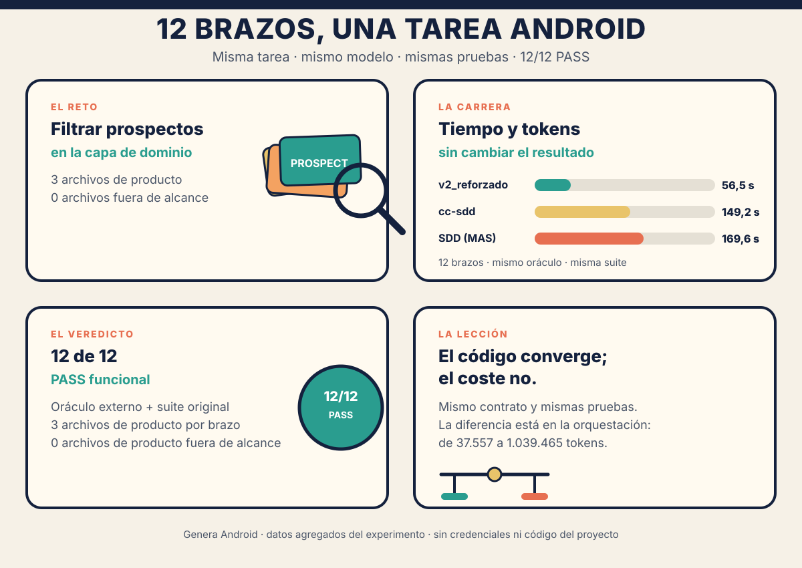

# Proyectos / arneses — comparativa sobre Genera Android

**Fecha:** 2026-11-09
**Tarea:** T1 media-baja `GBA-SEARCH-PROSPECTS` (adaptada a Genera)
**Modelo:** `openai/gpt-6-luna` (suscripción OpenAI, OAuth)
**Estado:** cerrado; 12/12 brazos ejecutados y evaluados.

## 1. Pregunta

¿Los arneses de agentes más parecidos al MAS administran mejor el tiempo y los
tokens en una tarea real de Android, y evitan la sobreingeniería, o llegan al
mismo resultado con más trabajo?

Se ejecuta **la misma tarea media-baja** con el mismo modelo, cambiando
únicamente el arnés que la resuelve. Se incluye un brazo de control
`v2_reforzado` ejecutado en esta misma base para que la comparación sea válida.
Se añade un brazo **SDD (MAS)** para medir el coste de la metodología
Spec-Driven Development sobre el mismo contrato y las mismas pruebas. Después se
auditan los cinco arneses externos y se ejecutan sus agentes SDD o de
planificación equivalentes: **superpowers-sdd** y **ecc-plan**. Se añade además
**cc-sdd**, un proyecto externo centrado en SDD y con soporte OpenCode, para
contrastar el SDD del MAS con un SDD externo completo. Se añaden también
**OpenSpec** y **Spec Kit** como proyectos SDD externos con integración OpenCode.

## 2. Base real y adaptación declarada

El experimento histórico de GPT-6 Luna usó `mobile-android.zip`
(paquete `com.example.mobilefixture`). Ese ZIP **ya no está en disco** y no se
pudo recuperar. La única base Android disponible es:

- `~/.local/share/ai-agents-kit/fixtures/mobile-android.zip`
- Paquete real: `mx.com.bancadigital.crm`
- Módulo objetivo: `:core:domain` (mismo, con `testBuildType = "release"`)

Para no perder el experimento se adaptó la tarea de forma **mecánica**, sin
cambiar reglas de negocio:

1. `com.example.mobilefixture` → `mx.com.bancadigital.crm` en textos, paquetes y
   rutas.
2. Oráculo reubicado a
   `core/domain/src/test/java/mx/com/bancadigital/crm/domain/use_case/prospect/OracleSearchProspectsTest.kt`.
3. Suite original: `mx.com.bancadigital.crm.domain.util.*`.
4. `Prospect.kt` de Genera contiene todos los campos que usa el oráculo
   (`id`, `razonSocial`, `rfc`, `nombreEmpleado`, `tipoCliente`, `idTipoCliente`,
   `marcaGestion`).

Adaptación y validación:

- [tarea-1-media-baja-genera.md](genera/tarea-1-media-baja-genera.md)
- [OracleSearchProspectsTest.kt](genera/OracleSearchProspectsTest.kt)
- El oráculo se validó contra una implementación de referencia: **PASS** (10/10
  pruebas) y la suite original `:core:domain` también **PASS**.
- Las cifras históricas de `v2_reforzado` (82,8 s / 95.164 tokens) **no** se
  usan como control porque pertenecen a otra base. Se ejecuta un control nuevo
  sobre Genera.

## 3. Brazos

| Arnés | Instalación en OpenCode | Artefactos |
|---|---|---|
| **v2_reforzado** | snapshot congelado del MAS (`agent-candidato2` + dos refuerzos) | skill `developer-v2`, `data-api`, `ui-design`; agente `pilot-v2_reforzado` |
| **wshobson/agents** | `make install-opencode` (generación + symlinks) | 202 agentes, 185 skills, 105 comandos |
| **obra/superpowers** | plugin V1 + skills | 15 skills + bootstrap de sesión |
| **affaan-m/ECC** | `install-apply --target opencode --profile developer --no-hooks` | 26 agentes, 134 skills, comandos y tools |
| **gentle-ai** | binario `4.4.0`; componentes `persona,skills,permissions,opencode-gentle-logo` | 9 skills + orquestador |
| **garrytan/gstack** | `./setup --host opencode --no-browser` | 62 skills de rol + comandos |
| **SDD (MAS)** | agente `sdd` + skill `sdd-spec` (`generated/opencode`) | spec SDD-Tiny; `data-api`/`ui-design` bajo demanda |
| **superpowers-sdd** | skills `writing-plans` + `subagent-driven-development` | plan en `docs/superpowers/plans/` y ejecución con subagentes |
| **ecc-plan** | subagente `planner` + `build` | plan de ECC y ejecución/revisión cooperativa |
| **cc-sdd** | `npx cc-sdd --opencode-skills`; 17 skills + `.kiro/settings` | flujo Kiro: discovery/quick spec, design, tasks e impl |
| **openspec** | `openspec init --tools opencode` | 6 skills + 6 comandos; cambios en `openspec/changes/` |
| **spec-kit** | `specify init . --integration opencode` | comandos `speckit.*`; specs en `specs/` |

### 3.1 Brazos SDD-like medidos

| Arnés | Agente SDD/planificación | Brazo |
|---|---|---|
| superpowers | `writing-plans`, `subagent-driven-development` | `superpowers-sdd` |
| ECC | `planner` + `build` + `code-reviewer` | `ecc-plan` |
| cc-sdd | 17 skills Kiro/SDD: spec/design/tasks/impl | `cc-sdd` |
| OpenSpec | 6 skills y 6 comandos OpenCode | `openspec` |
| Spec Kit | comandos `speckit.*` para OpenCode | `spec-kit` |

Detalle y justificación: [seleccion-arneses.md](seleccion-arneses.md).
Protocolo y desviaciones: [protocolo.md](protocolo.md).

## 4. Aislamiento

Cada brazo tiene:

- Copia propia del proyecto en `…/T/opencode/proyectos-arneses-comparativa/task_1/runs/<brazo>/`.
- `HOME`, `XDG_CONFIG_HOME` y `OPENCODE_CONFIG_DIR` propios en `…/task_1/profiles/<brazo>/`.
- Sin acceso a la configuración global real ni a skills externas.
- Sin `webfetch`, `websearch`, MCP ni red desde el agente.
- Bash limitado a `./gradlew`, `git status/diff/log/show/ls-files`.
- Secretos, credenciales, `local.properties`, `.secrets` y keystores en `deny`.
- Sin commits ni cambios fuera del workspace.

### 4.1 Sin llamadas a los servicios del proyecto

La tarea se resuelve y se evalúa en la capa de dominio, no contra el backend:

- El oráculo y el test nuevo construyen objetos `Prospect` en memoria y llaman
  directamente a `FixtureSource1`; no arrancan la app ni usan Retrofit,
  OkHttp, repositorios reales, base de datos o endpoints del CRM.
- La suite original `mx.com.bancadigital.crm.domain.util.*` es de utilidades de
  dominio; los tests que usan repositorios los sustituyen con mocks. Tampoco
  consulta servicios reales.
- El agente no tiene `webfetch`, `websearch`, MCP ni herramientas HTTP, y su
  `bash` está limitado a `./gradlew` y comandos `git` de lectura.
- `local.properties` contiene credenciales, pero el agente no puede leerlo; Gradle
  lo usa solo para configurar el build. La única red posible es la resolución de
  dependencias de Gradle si no estuvieran en caché, y eso es tooling de build,
  no una consulta a los servicios del proyecto.

Por tanto, **no se realizaron consultas a los servicios del CRM y no son
necesarias para esta prueba**.

## 5. Métricas

Por brazo:

- **Tiempo** total de la ejecución.
- **Tokens**: `input + output + cache_read + cache_write + reasoning`.
- **Pasos** y **tool calls**.
- **Oráculo externo** y **suite original** (cero regresión).
- **Archivos tocados**, **archivos fuera de alcance**, **tests nuevos**, **líneas de producto**.
- **Artefactos de proceso**: para SDD, `spec.md` y líneas de metodología, contabilizados aparte del código.
- **Motivo de parada** y errores.
- Señales de sobreingeniería: archivos extra, capas/abstracciones no pedidas,
  tests triviales, refactors no solicitados.

## 6. Resultados

Los doce brazos resolvieron la tarea. Todos tocaron exactamente los **3 archivos
de producto esperados**, con **0 archivos fuera de alcance**. SDD añadió su
`spec.md` (28 líneas), superpowers-sdd su plan (45), cc-sdd cuatro artefactos (61),
OpenSpec su cambio (85) y Spec Kit su spec/plan/tasks (84), contabilizados aparte.

| Arnés | Agente | Aceptación | Tiempo | Tokens | vs. control (tok) | Pasos | Tool calls | Archivos | Líneas producto | `@Test` |
|---|---|:---:|---:|---:|---:|---:|---:|---:|---:|---:|
| **v2_reforzado** | `pilot-v2_reforzado` | ✅ PASS | **56,5 s** | **37.557** | 1,0× | **5** | **4** | **3** | **141** | 4 |
| wshobson | `build` | ✅ PASS | 104,0 s | 297.061 | 7,9× | 13 | 14 | 3 | 157 | 5 |
| superpowers | `build` | ✅ PASS | 119,5 s | 95.146 | 2,5× | 9 | 9 | 3 | 156 | 6 |
| ecc | `build` | ✅ PASS | 101,0 s | 524.947 | 14,0× | 12 | 15 | 3 | 169 | 7 |
| gentle-ai | `gentle-orchestrator` | ✅ PASS | 90,7 s | 274.726 | 7,3× | 10 | 12 | 3 | 155 | 5 |
| gstack | `build` | ✅ PASS | 128,6 s | 179.466 | 4,8× | 15 | 15 | 3 | 163 | 6 |
| **SDD (MAS)** | `sdd` | ✅ PASS | 169,6 s | 556.973 | 14,8× | 23 | 26 | 4 | 181 | 5 |
| **superpowers-sdd** | `pilot-superpowers-sdd` | ✅ PASS | 395,7 s | 351.253 | 9,4× | 17 | 21 | 4 | 186 | 6 |
| **ecc-plan** | `build` | ✅ PASS | 209,7 s | 1.039.465 | 27,7× | 21 | 25 | 3 | 157 | 6 |
| **cc-sdd** | `pilot-cc-sdd` | ✅ PASS | 149,2 s | 463.013 | 12,3× | 22 | 23 | 7 | 102 | 4 |
| **openspec** | `pilot-openspec` | ✅ PASS | 203,3 s | 493.543 | 13,1× | 26 | 25 | 9 | 135 | 6 |
| **spec-kit** | `pilot-spec-kit` | ✅ PASS | 192,3 s | 599.483 | 16,0× | 28 | 32 | 6 | 156 | 5 |

Artefactos de metodología:

- **SDD**: `.sdd/specs/core-domain-filter-prospects/spec.md` (28 líneas).
- **superpowers-sdd**: `docs/superpowers/plans/2026-11-09-filter-prospects.md` (45 líneas).
- **ecc-plan**: el plan se devolvió en el resultado del subagente `planner`; no se escribió un archivo.
- **cc-sdd**: `.kiro/specs/filter-prospects/{requirements,design,tasks}.md` + `spec.json` (61 líneas).
- **openspec**: `openspec/changes/gba-search-prospects/` (proposal, specs, design, tasks; 85 líneas contando el `.gitkeep`).
- **spec-kit**: `specs/001-prospect-search-filter/{spec,plan,tasks}.md` (84 líneas).

Desglose de tokens:

| Arnés | input | output | reasoning | cache read | total |
|---|---:|---:|---:|---:|---:|
| v2_reforzado | 15.823 | 2.022 | 0 | 19.712 | 37.557 |
| wshobson | 51.927 | 3.149 | 65 | 241.920 | 297.061 |
| superpowers | 14.406 | 2.733 | 55 | 77.952 | 95.146 |
| ecc | 48.668 | 3.231 | 88 | 472.960 | 524.947 |
| gentle-ai | 31.368 | 2.865 | 109 | 240.384 | 274.726 |
| gstack | 77.526 | 3.889 | 259 | 97.792 | 179.466 |
| sdd | 34.691 | 5.193 | 993 | 516.096 | 556.973 |
| superpowers-sdd | 30.030 | 3.475 | 436 | 317.312 | 351.253 |
| ecc-plan | 59.824 | 4.664 | 1.025 | 973.952 | 1.039.465 |
| cc-sdd | 67.488 | 4.544 | 453 | 390.528 | 463.013 |
| openspec | 45.506 | 5.066 | 91 | 442.880 | 493.543 |
| spec-kit | 45.088 | 5.512 | 403 | 548.480 | 599.483 |

Oráculo y regresión: **oráculo PASS y suite original PASS en los 12 brazos**.
Cada brazo añadió **1 archivo de test nuevo**.

### Nota sobre gentle-ai

El primer intento de gentle-ai terminó con 0 archivos y el oráculo en FAIL. La
causa fue un defecto del **runner del benchmark**, no del arnés: al fusionar el
sandbox, la regla comodín `"*": "deny"` quedó al final del objeto `permission` y
OpenCode la aplicó con semántica de última coincidencia, ocultando las
herramientas de archivo. Se corrigió `merge_sandbox` para colocar `"*"` primero,
se reinstaló el perfil aislado y se repitió **solo** ese brazo. El resultado
válido es el PASS de la tabla. El FAIL inicial **no** se usa como resultado del
arnés.

El aviso `[skill-registry] ... refresh (ENOENT)` de gentle-ai sigue apareciendo
en `stderr`; es un refresco best-effort y no bloqueó la ejecución.

### Nota sobre SDD

SDD creó `.sdd/specs/core-domain-filter-prospects/spec.md` (SDD-Tiny, 28 líneas)
antes del código y lo actualizó al cerrar. El Gate 3 se preaprobó en el prompt
para evitar preguntas interactivas; el Gate 4 quedó como cierre formal pendiente.
El host bloqueó la lectura directa de referencias de `sdd-spec` fuera del
workspace (p. ej. `workspace-trust.md`), pero el agente siguió el cuerpo de la
skill, implementó y verificó. Es una limitación del perfil aislado, no un fallo
funcional; se declara en las limitaciones.

### Nota sobre superpowers-sdd

El primer intento no pudo cargar `writing-plans` ni `subagent-driven-development`
porque el sandbox no permitía la herramienta `skill`; el agente se detuvo sin
tocar código. Se añadió `skill: allow` al sandbox de este brazo y se repitió. En
la corrida válida usó ambas skills, creó un plan de 45 líneas, implementó con un
subagente, revisó, corrigió el orden y verificó. Es un flujo **cooperativo**:
padre + implementador + revisor.

### Nota sobre ecc-plan

El agente `build` invocó al subagente `planner` mediante `task`, implementó el
plan y después usó `code-reviewer`. El plan quedó en el resultado del subagente,
no en un archivo. Es el brazo con más tokens (27,7×), casi todo `cache_read`
(973.952), por el contexto acumulado entre planificador, implementación y
revisión.

### Nota sobre cc-sdd

El primer intento cargó `kiro-impl` sin generar el spec y terminó como una
implementación directa. Se añadió un piloto `pilot-cc-sdd` con la obligación de
ejecutar `kiro-spec-quick --auto` antes de escribir código y se repitió. En la
corrida válida generó `requirements.md`, `design.md`, `tasks.md` y `spec.json`
(61 líneas), implementó y verificó. Es el **SDD-like más rápido** (149,2 s) y el
que menos código de producto escribió (102 líneas), con 4 tests.

### Nota sobre openspec

OpenSpec creó el cambio `gba-search-prospects` con proposal, specs, design y
tasks (85 líneas contando el `.gitkeep`), usó su CLI local y luego aplicó el
cambio. Pasó oráculo y suite con 135 líneas de producto y 6 tests. Es el segundo
brazo SDD-like con menos tokens (493.543).

### Nota sobre spec-kit

El primer intento leyó los comandos pero no creó los artefactos y se detuvo. Se
añadió un piloto que exige `specs/<feature>/{spec,plan,tasks}.md` antes de
código; tras habilitar el directorio `specs/` en el sandbox, la segunda corrida
creó los tres archivos (84 líneas), implementó y verificó. Es el brazo con más
pasos (28) y más tokens del grupo después de ecc-plan (599.483).

## 7. Sobreingeniería

En los cinco arneses base y en el control **no se observó sobreingeniería de
artefactos**. Los brazos SDD añaden artefactos de proceso por diseño: `spec.md`
de 28 líneas en el SDD del MAS, plan de 45 en superpowers-sdd, cuatro artefactos
de 61 en cc-sdd, cambio de 85 en OpenSpec y spec/plan/tasks de 84 en Spec Kit;
ecc-plan devolvió el plan en el resultado del subagente, sin archivo.

- Los doce usan la misma forma exigida por el oráculo: `interface` +
  `FixtureSource1Impl` y un `FixtureSource3` idéntico de 7 líneas.
- La implementación principal mide 53–82 líneas. La mayoría usa 1–2 helpers
  privados (`normalize`, `isGestionado`) y `compareBy`/`sortedWith`.
- **gstack**, **superpowers-sdd** y **spec-kit** escriben comparadores manuales;
  superpowers-sdd añade helpers de comparación nullable y llega a 82 líneas (+22
  sobre el control). No añaden capas ni archivos de producto.
- **gentle-ai**, **SDD**, **superpowers-sdd**, **cc-sdd**, **openspec** y
  **spec-kit** usan regex de marcas combinantes; gentle-ai y SDD la precompilan
  en un `companion object`.
- **ECC**, **superpowers-sdd**, **cc-sdd**, **openspec** y **spec-kit** añaden
  tests (4–7 frente a 4 del control): resultado vacío, nulos/espacios, no mutación
  y orden.
- **superpowers-sdd** produce 186 líneas de producto (el mayor, +45 sobre el
  control), 6 tests y un plan de 45 líneas. **SDD** produce 181 líneas, 5 tests y
  un spec de 28 líneas. **ecc-plan** produce 157 líneas y 6 tests, sin archivo de
  plan. **spec-kit** produce 156 líneas, 5 tests y 84 líneas de spec/plan/tasks.
  **openspec** produce 135 líneas, 6 tests y 85 líneas de cambio. **cc-sdd**
  produce 102 líneas, 4 tests y 61 líneas de spec.
- Ningún brazo modificó `build.gradle`, `settings.gradle` ni archivos de build.

La sobreingeniería, medida como **trabajo total**, sí aparece en el proceso: los
brazos no-control necesitaron **9–28 pasos** y **2,5–27,7×** los tokens del control
para producir el mismo contrato funcional. ecc-plan es el extremo en contexto
(27,7×, de los cuales 973.952 son `cache_read`); superpowers-sdd es el más lento
(7,0× tiempo, 395,7 s). cc-sdd es el más rápido del grupo SDD-like (2,6× tiempo)
pero paga 12,3× tokens.

## 8. Lectura

- **Eficiencia**: `v2_reforzado` gana en tiempo (56,5 s) y tokens (37.557) con
  5 pasos. Es el control y, en esta tarea, también el mejor resultado absoluto.
- **Mejor externo en tokens**: `superpowers` (2,5×), pero paga 2,1× en tiempo.
- **Mejor externo en tiempo**: `gentle-ai` (1,6×), pero con 7,3× tokens y un
  orquestador que delega; su resultado final es correcto.
- **Grupo SDD-like**:
  - **cc-sdd**: 149,2 s (2,6×), 463.013 tokens (12,3×), 22 pasos y 4 artefactos
    de spec (61 líneas). Es el **más rápido** y el que menos producto escribe
    (102 líneas).
  - **SDD (MAS)**: 169,6 s (3,0×), 556.973 tokens (14,8×), 23 pasos y un spec de
    28 líneas. Segundo en tiempo; cuarto en tokens.
  - **spec-kit**: 192,3 s (3,4×), 599.483 tokens (16,0×), 28 pasos y tres
    artefactos de spec (84 líneas). Es el que más pasos da y el que más tokens usa
    después de ecc-plan; en tiempo queda por detrás de cc-sdd y del SDD del MAS,
    pero por delante de OpenSpec y ecc-plan.
  - **openspec**: 203,3 s (3,6×), 493.543 tokens (13,1×), 26 pasos y un cambio
    (85 líneas). Usa menos tokens que el SDD del MAS, pero es más lento.
  - **superpowers-sdd**: 395,7 s (7,0×), 351.253 tokens (9,4×), 17 pasos y un plan
    de 45 líneas. Es el **más lento**, pero usa menos tokens que todos los demás
    SDD-like; pagó el coste en tiempo de los subagentes y la revisión.
  - **ecc-plan**: 209,7 s (3,7×), 1.039.465 tokens (27,7×), 21 pasos. Es el
    **mayor coste de contexto**, por el planificador y el revisor encadenados.
- **Peor coste de contexto**: `ecc-plan` (27,7×), seguido de `spec-kit` (16,0×) y
  `sdd` (14,8×). **Peor tiempo**: `superpowers-sdd` (395,7 s), seguido de
  `ecc-plan` (209,7 s) y `openspec` (203,3 s).
- **Conclusión del contraste SDD**: en esta tarea, **cc-sdd externo supera al SDD
  del MAS** en tiempo (149,2 vs 169,6 s) y tokens (463.013 vs 556.973), con más
  artefactos de spec (4 vs 1). **OpenSpec** también usa menos tokens (493.543),
  pero es más lento. **Spec Kit** es más lento y más caro en tokens. El SDD del
  MAS queda en la zona media: no es el más caro, pero tampoco el más eficiente;
  su ventaja es un flujo simple y un solo artefacto.
- Todos los caminos convergen al mismo contrato y a los mismos 3 archivos de
  producto. En una tarea media-baja y bien especificada, el arnés más grande o la
  metodología más formal no aportan una ventaja funcional; aportan más
  exploración, más contexto, más pasos y, en SDD, artefactos de trazabilidad.

## 9. Limitaciones

- Una sola ejecución por brazo; las diferencias de pocos segundos no son
  estadísticamente concluyentes.
- Tarea media-baja y contrato muy explícito: favorece la convergencia y reduce
  el espacio para que un arnés demuestre ventajas de planificación.
- El total de tokens incluye `cache_read`; no es un coste monetario. Para coste
  habría que aplicar precios por modelo y proveedor.
- La base es Genera, no el ZIP histórico; la adaptación es mecánica y está
  declarada, pero no es la misma base que las cifras históricas.
- **SDD**: el Gate 3 se preaprobó en el prompt de ejecución para evitar preguntas
  interactivas; el agente creó el `spec.md` Tiny y cerró la verificación, pero el
  Gate 4 quedó como cierre formal pendiente (no hay usuario en la corrida).
- **SDD**: el host no permitió leer directamente referencias de la skill fuera
  del workspace (p. ej. `workspace-trust.md`; en una corrida previa también
  `scope-depth.md`). El agente siguió con el cuerpo de `sdd-spec`, creó el spec y
  verificó; es una limitación del perfil aislado, no un fallo funcional. Se
  declara para no sobreinterpretar la calidad metodológica del brazo.
- **superpowers-sdd** y **ecc-plan** son corridas **cooperativas** (padre +
  subagentes), no un único agente. Su tiempo y tokens incluyen planificación,
  implementación y revisión; no son comparables uno a uno con un agente que
  trabaja inline.
- **superpowers-sdd** necesitó habilitar la herramienta `skill`; el primer intento
  se detuvo sin tocar código. Se repitió tras el ajuste y el resultado de la tabla
  es el válido.
- **ecc-plan** no dejó un archivo de plan; el plan quedó en el resultado del
  subagente `planner`. Se contabiliza como metodología sin líneas de artefacto.
- **gstack**, **wshobson** y **gentle-ai** se midieron con su agente por defecto;
  no se añadió un sub-brazo SDD separado.
- **cc-sdd**: el primer intento cargó `kiro-impl` sin generar el spec. Se añadió
  un piloto que obliga a `kiro-spec-quick --auto` antes de código y se repitió;
  el resultado de la tabla es el válido. Los archivos de instalación
  (`.opencode/skills`, `.kiro/settings`) se excluyeron de Git para no contarlos
  como producto ni como metodología generada.
- **OpenSpec**: se instaló con `openspec init`; los archivos de instalación
  (`.opencode/`, `openspec/config.yaml`) se excluyeron de Git. El cambio generado
  bajo `openspec/changes/` sí se contabiliza como metodología.
- **Spec Kit**: el primer intento no pudo crear `specs/` porque el directorio no
  existía al fusionar el sandbox y no tenía regla de escritura. Se creó el
  directorio y se repitió; el resultado de la tabla es el válido. Los artefactos
  de instalación (`.opencode/`, `.specify/`) se excluyeron de Git.

## 10. Evidencia

- Resultados consolidados: [`resultados.json`](resultados.json). Es un **resumen
  agregado** sin rutas locales, credenciales ni código del proyecto; la evidencia
  cruda (`preflight`, `events`, `run`) permanece en el laboratorio local, fuera
  del repositorio.
- Evidencia por brazo: `…/task_1/evidence/<brazo>-{install,preflight,run,eval}.json`.
- Trazas crudas: `<brazo>-events.jsonl`.
- SDD: `.sdd/specs/core-domain-filter-prospects/spec.md` en la copia de trabajo y
  `sdd-events.jsonl` en la evidencia.
- OpenSpec: `openspec/changes/gba-search-prospects/` en la copia de trabajo y
  `openspec-events.jsonl` en la evidencia.
- Spec Kit: `specs/001-prospect-search-filter/` en la copia de trabajo y
  `spec-kit-events.jsonl` en la evidencia.
- Laboratorio: `…/T/opencode/proyectos-arneses-comparativa/`.
- Referencia verificable: [referencia/README.md](referencia/README.md).

## 11. Cómic

Resumen visual del experimento, sin datos sensibles del proyecto:

