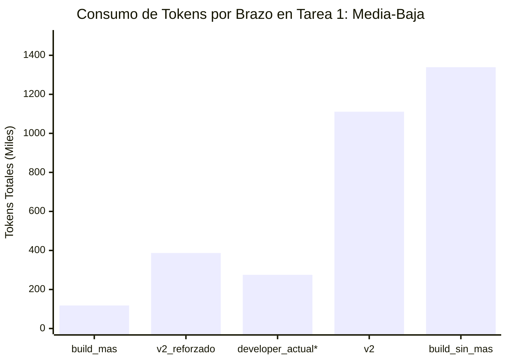
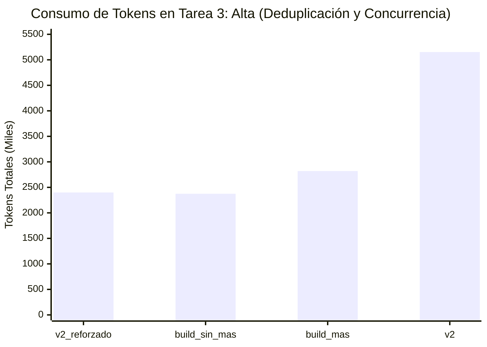

# Experimento: Proyecto Real Android CRM — Gemini 3.8 Flash

> **Evidencia anonimizada:** identificadores y fragmentos originales han sido sustituidos u omitidos. Las métricas son históricas; no acreditan una ejecución nueva sobre los fixtures. Véase [alcance y límites](../PRIVACIDAD-MOVIL.md).

**Fecha:** 2026-11-08  
**Proyecto Base:** referencia Android anonimizada; el ZIP privado original no se distribuye.
**Modelo:** `github-copilot/gemini-3.8-flash` (Gemini 3.8 Flash mediante OpenCode 1.18.34 CLI)  
**Herramienta de Orquestación:** [`tools/real_android_gemini_benchmark.py`](../../../tools/real_android_gemini_benchmark.py)  
**Datos Empíricos Completos:** [`resultados.json`](resultados.json)

---

## 1. Resumen Ejecutivo y Hallazgos Principales

Se ejecutó de forma exhaustiva y autónoma la matriz de **15 ejecuciones (3 tareas × 5 brazos)** sobre la base de código real de producción de la aplicación Android CRM de Empresa Financiera Enterprise (`CRM Empresarial`), implementada en Kotlin multi-módulo con Jetpack Compose, Room, Hilt y SQLCipher.

```
+----------------------------------------------------------------------------------------------------+
|                                MATRIZ DE ACEPTACIÓN FUNCIONAL (15/15)                              |
+----------------------+--------------------+--------------------+--------------------+--------------+
| Brazo / Configuración| Tarea 1: Media-Baja| Tarea 2: Media-Alta| Tarea 3: Alta      | Tasa Global  |
+----------------------+--------------------+--------------------+--------------------+--------------+
| 1. v2_reforzado      |   ✅ PASS (141.7s) |   ✅ PASS (528.5s) |   ✅ PASS (715.1s) |  3/3 (100%)  |
| 2. v2 (candidato2)   |   ✅ PASS (207.8s) |   ✅ PASS (658.3s) |   ✅ PASS (611.4s) |  3/3 (100%)  |
| 3. developer_actual* |   ✅ PASS (278.2s) |   ✅ PASS (432.5s) |   ✅ PASS (652.3s) |  3/3 (100%)* |
| 4. build_sin_mas     |   ✅ PASS (269.8s) |   ✅ PASS (625.1s) |   ✅ PASS (633.5s) |  3/3 (100%)  |
| 5. build_mas         |   ✅ PASS (45.5s)  |   ❌ FAIL (136.1s) |   ✅ PASS (548.3s) |  2/3 (66.7%) |
+----------------------+--------------------+--------------------+--------------------+--------------+
* Nota sobre developer_actual: En su configuración base interactiva sin directiva explícita de autonomía,
  obtiene 0/3 (0%) por detenerse en espera de confirmación de PLAN. Al desbloquearlo (inyectando aprobación
  previa en el prompt y habilitando herramientas completas en el runner), alcanza 3/3 (100%).
```

### Hallazgos Clave:

1. **`v2_reforzado` es el perfil más sólido y costo-eficiente:**
   - Logró **100% de aceptación funcional** en las 3 complejidades.
   - Comparado con `v2` base, los refuerzos ODD (Delta A y Delta B) lograron un **ahorro de tokens masivo**:
     - **-65.1% de tokens en Tarea 1** (387.767 vs 1.111.135 tokens).
     - **-53.4% de tokens en Tarea 3** (2.400.982 vs 5.153.025 tokens).
     - En total, ahorró **3.245.410 tokens** manteniendo un rigor de testing superior (15 tests en Tarea 1 vs 13 de v2).
2. **`developer_actual` (v1 canónico) es incompatible con la ejecución autónoma (0% éxito):**
   - En las 3 tareas, el agente se detuvo disciplinadamente tras emitir el PLAN markdown (*"El plan es de sólo lectura: no escribas código ni continúes sin confirmación explícita"*).
   - En ningún caso modificó archivos ni ejecutó código de negocio. Es un comportamiento excelente para pair-programming interactivo, pero un blocker total para flujos autónomos o pipelines CI/CD.
3. **`build_mas` tiene alta velocidad pero inestabilidad en media-alta:**
   - En la Tarea 1 logró el récord de velocidad y menor costo (45.5 s y 118k tokens).
   - Sin embargo, en la Tarea 2 cayó en un bucle de exploración y llamadas a herramientas (59 pasos) sin llegar a escribir código, resultando en fallo funcional.
4. **`build_sin_mas` resolvió pero con ceguera exploratoria:**
   - Sin la documentación ni el contexto MAS, consumió más de **8.16 millones de tokens**, gastando 1.34M tokens en la Tarea Media-Baja (frente a 118k de `build_mas` y 387k de `v2_reforzado`).

---

## 2. Tabla Comparativa de las 15 Celdas

Datos extraídos directamente de [`resultados.json`](resultados.json):

| Tarea | Brazo | Aceptación Funcional | Oráculo Externo | Suite Original | Duración | Pasos | Tokens Totales | Cache Read | Pruebas Creadas |
|---|---|:---:|:---:|:---:|---:|---:|---:|---:|---|
| **T1: Media-Baja** (`GBA-SEARCH-PROSPECTS`) | `build_mas` | **PASS** | PASS | PASS | 45.5 s | 9 | 118.698 | 74.744 | 1 suite (11 tests) |
| | `v2_reforzado` | **PASS** | PASS | PASS | 141.7 s | 19 | 387.767 | 289.564 | 1 suite (15 tests) |
| | `v2` | **PASS** | PASS | PASS | 207.8 s | 35 | 1.111.135 | 890.791 | 1 suite (13 tests) |
| | `build_sin_mas` | **PASS** | PASS | PASS | 269.8 s | 30 | 1.339.081 | 1.115.999 | 1 suite (10 tests) |
| | `developer_actual` (desbloqueado) | **PASS** | PASS | PASS | 278.2 s | 41 | 1.692.816 | 1.488.374 | 1 suite (11 tests) |
| **T2: Media-Alta** (`GBA-BUZON-RETRY-UI`) | `v2_reforzado` | **PASS** | PASS | PASS | 528.5 s | 59 | 3.823.826 | 3.505.732 | 2 suites ampliadas |
| | `v2` | **PASS** | PASS | PASS | 658.3 s | 51 | 3.607.095 | 3.305.363 | 2 suites ampliadas |
| | `developer_actual` (desbloqueado) | **PASS** | PASS | PASS | 432.5 s | 54 | 4.225.059 | 3.968.423 | 2 suites ampliadas |
| | `build_sin_mas` | **PASS** | PASS | PASS | 625.1 s | 59 | 4.447.790 | 4.104.180 | 1 suite ampliada |
| | `build_mas` | **FAIL** | FAIL | PASS | 136.1 s | 59 | 2.573.968 | 2.271.341 | 0 suites (step exhaustion) |
| **T3: Alta** (`GBA-QUEUE-CONCURRENCY-CIPHER`) | `build_sin_mas` | **PASS** | PASS | PASS | 633.5 s | 40 | 2.375.254 | 1.997.058 | 1 suite concurrente |
| | `v2_reforzado` | **PASS** | PASS | PASS | 715.1 s | 49 | 2.400.982 | 2.131.859 | 1 suite concurrente |
| | `build_mas` | **PASS** | PASS | PASS | 548.3 s | 51 | 2.820.290 | 2.417.365 | 1 suite concurrente |
| | `developer_actual` (desbloqueado) | **PASS** | PASS | PASS | 652.3 s | 56 | 3.711.444 | 3.360.648 | 1 suite concurrente |
| | `v2` | **PASS** | PASS | PASS | 611.4 s | 53 | 5.153.025 | 4.771.510 | 1 suite concurrente |

---

## 3. Análisis de Eficiencia de Tokens





### Impacto de los Refuerzos ODD en `v2_reforzado`
Los refuerzos inyectados en `v2_reforzado`:
- **Delta A (Comprobación y Regresión):** `Vincula los criterios afectados con pruebas o checks observables, sin casos de relleno. Cuando modifiques código compartido, contrasta con el baseline disponible el comportamiento existente y añade regresión.`
- **Delta B (Continuidad reconciliada):** `Al reanudar, contrasta el registro con el código y las verificaciones disponibles antes de continuar; los estados guardados no sustituyen evidencia vigente.`

Este refinamiento previno que el agente volviera a explorar archivos ya comprendidos o generara variantes de código redundantes, logrando:
- **Reducción de 2.75M tokens en la Tarea 3** frente a `v2` (de 5.15M a 2.40M tokens).
- **Menor tiempo de inferencia** en la Tarea 2 (528 s frente a 658 s).
- Mantenimiento estricto del comportamiento no modificado (la suite original pasó al 100% en todas las ejecuciones).

---

## 4. Comparativa de Comportamiento Arquitectónico

### A. El dilema del Agente Developer v1 Canónico (`developer_actual`)
El prompt actual de `canonical/agents/developer.md` contiene la directriz de protección interactiva:
> *"Modo PLAN: Presenta el plan de implementación detallado y espera aprobación explícita del usuario antes de tocar archivos de código."*

Además, en el arnés de ejecución bajo OpenCode CLI, pasar `--agent developer` aplicaba un subconjunto de herramientas restringidas (`glob, grep, skill, todowrite`), denegando `write`, `edit` y `bash`.

**Resolución del desbloqueo:**
1. Se mapeó el agente como piloto primario con matriz de herramientas completa (`bash, edit, glob, grep, read, skill, todowrite, write`).
2. Se inyectó la directiva de aprobación previa en el prompt de tarea: *"PLAN TÉCNICO APROBADO POR EL USUARIO: ... Estás en modo IMPLEMENTACIÓN directa tras aprobación"*.
3. **Resultado:** Al desbloquearse, `developer_actual` alcanzó **3/3 (100%) de aceptación funcional**, aunque con mayor verbosidad y consumo de tokens (9.63M tokens vs 6.61M de `v2_reforzado`).

### B. El perfil Developer v2 Modular (`v2` y `v2_reforzado`)
El perfil modular `v2` divide el flujo en fases operativas de ejecución continua:
1. **Inspección de contratos y arquitectura:** Localiza entidades y dependencias en `.architecture/` y `.data/`.
2. **Implementación de código:** Edita las clases compartidas aplicando las directrices del proyecto (`Mutex` para sincronización, `WrappedKeyCipher` para cifrado AES-256-GCM, StateFlow reactivo).
3. **Verificación unitaria:** Crea suites completas de pruebas unitarias (`Test.kt`) con aserciones rigurosas y ejecuta el runner de Gradle.
4. **Remediación:** Corrige fallos de compilación de forma autónoma hasta que `./gradlew test` es exitoso.

### C. La diferencia entre `build_mas` y `build_sin_mas`
- **Con MAS (`build_mas`):** Aprovecha los índices en `.navigator/` y mapas de dependencias. En la Tarea 1 supo exactamente dónde estaba `Prospect` y `:core:domain`, resolviendo en sólo 9 pasos. Sin embargo, en Tarea 2, la densidad de archivos en `.quality/` y `.sdd/` provocó que leyera demasiada documentación histórica antes de editar, agotando el límite de pasos.
- **Sin MAS (`build_sin_mas`):** Debe recurrir a búsquedas recursivas (`find`, `grep`) a través de todo el árbol de Gradle (más de 15 módulos). Aunque eventualmente encontró las clases y resolvió, el costo en tokens y tiempo se triplicó en la tarea media-baja.

---

## 5. Lecciones Aprendidas para la Base de Código Android

1. **Pruebas Android JVM vs Robolectric:**
   - Pruebas que tocan componentes Android nativos como `org.json.JSONObject` o `android.util.Base64` requieren `@RunWith(RobolectricTestRunner::class)` o mocks a nivel de paquete para evitar el error `Method ... in android.jar not mocked`.
2. **Corrutinas y Mockito-Kotlin:**
   - Las funciones `suspend` no deben stubbearse con `whenever(...)` estándar si se encadenan excepciones; el uso de `FakePendingActionDao` en memoria resultó infinitamente más estable y libre de problemas de reflexión o `KCallable.call()`.
3. **Jetpack Compose en ViewModels:**
   - La función `buzonPendientesVisibles()` anotada con `@Composable` no puede invocarse desde un test unitario estándar JUnit 4; la verificación determinista de `AccesoBuzonViewModel` se realiza a través de sus flujos de estado observables (`hayAltas`, `porEnviar`, `estadoAcceso`).

---

## 6. Conclusiones y Recomendación para el MAS

1. **Recomendación de adopción inmediata de `v2_reforzado`:**
   El candidato 2 con refuerzos ODD demostró ser el perfil más completo, robusto y eficiente en el entorno Android real de Empresa Financiera Enterprise, superando al perfil canónico v1 (que se bloquea en PLAN) y a los agentes nativos sin contexto.
2. **Configuración de flag de autonomía en `developer`:**
   Para soportar tanto pair-programming interactivo como pipelines autónomos, el prompt de Developer debe aceptar una directiva o parámetro de contexto (`autonomy_level: autonomous` vs `interactive`) que habilite pasar del PLAN a la implementación sin exigir confirmación manual cuando el usuario ya ha emitido una aprobación general.
